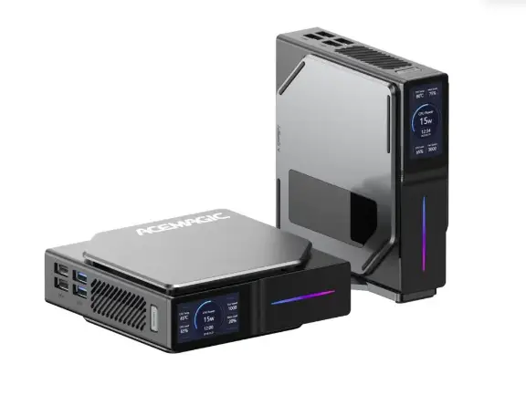
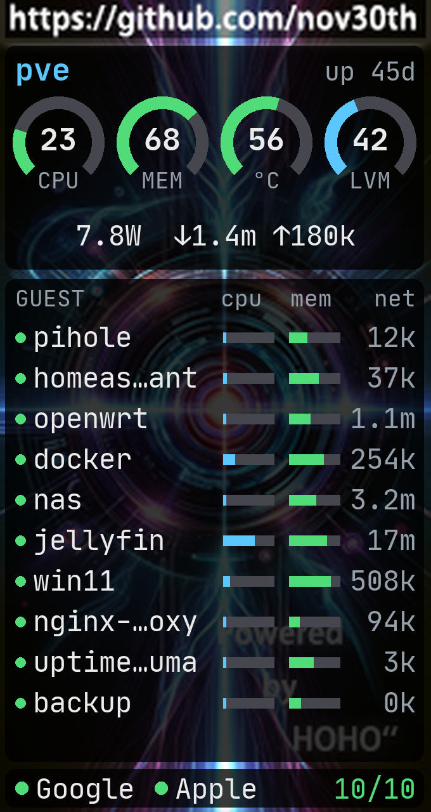
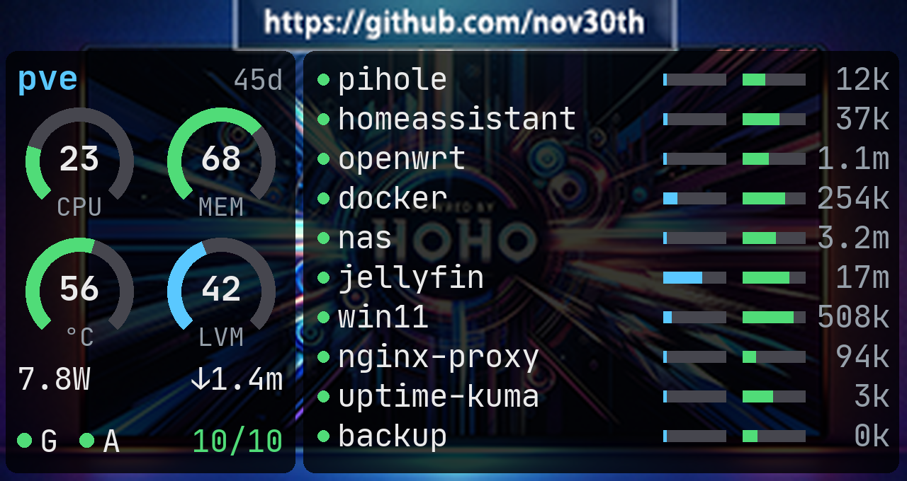
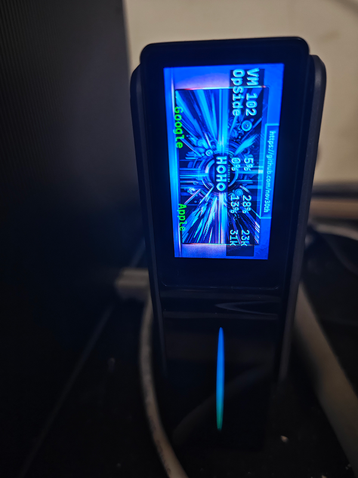
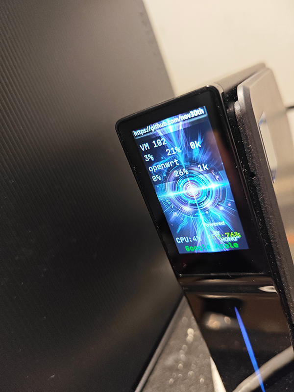

# AceMagic S1 Screen for Proxmox VE



> **2026-10-12 正式开源 / Open-sourced on 2026-10-12**
>
> 2024 年买了 AceMagic S1 当 PVE 服务器，顺手逆向了前面板的小屏幕，写了这个程序，一直自己在用。
> 当初说过要开源，但一直没时间整理代码。现在有了 AI 工具帮忙，终于把代码整理干净、补上文档，正式开源。
>
> I bought an AceMagic S1 in 2024 as a Proxmox VE server, reverse-engineered its front screen and have been running
> this program on it ever since. I always meant to open-source it but never found time to clean it up.
> With today's AI tools that finally became easy, so here it is - tidied up, documented and open.

| 竖屏 Portrait | 横屏 Landscape |
|:---:|:---:|
|  |  |

实机照片 / On the real device:

 

**[中文](#中文) | [English](#english)**

---

## 中文

### 功能

- **宿主机概览（圆环）**：CPU、内存、CPU 温度、一个存储的使用率，外加整机功耗（RAPL）和网卡上下行速度
- **虚拟机列表（细进度条）**：所有运行中的 VM / CT，每行显示 CPU、内存和网速；设置了开机自启（onboot）却没在运行的会标红显示 `STOPPED`
- **告警背景**：超过阈值时自动切换到 warn / error 背景图，可选联动前面板灯条
- **外网检测**：底部显示 Google / Apple 是否可达，支持 SOCKS5 代理
- **夜间熄屏**：指定时间段黑屏（固件没有关屏或亮度命令），灯条同时切换到夜间预设
- **竖屏 / 横屏**两种排版，顶部留空，露出背景图自带的文字
- 用**只读 API Token** 访问 PVE（`PVEAuditor` 角色），可一键创建，不需要在配置里写 root 密码
- 菜单 + 命令行参数，一键安装或卸载开机自启（systemd）
- 依赖全部来自 Debian 官方源，不需要 pip，也不需要 libusb 或 hidapi

### 安装（在 PVE 宿主机上，以 root 运行）

```bash
apt install -y git
git clone -b source-code https://github.com/nov30th/s1-mini-computer-tft-screen-release.git /opt/s1screen
cd /opt/s1screen
./s1screen.py install
```

`install` 会依次完成：

1. 用 apt 安装依赖：`python3-pil python3-numpy python3-psutil python3-requests python3-socks python3-serial`
2. 停用旧版闭源程序（`core.bin`）的 systemd 服务
3. 从 `config.example.toml` 生成 `config.toml`，并询问是否创建只读 API Token
4. 安装 `s1screen.service` 并设为开机自启

已在 Proxmox VE 8.4（Debian 12，Python 3.11）上测试，需要 Python 3.11 或更新版本。

### 菜单与命令

不带参数直接运行 `./s1screen.py` 会打开菜单。每个菜单项也都有对应的命令：

| 命令 | 作用 |
|---|---|
| `./s1screen.py install` | 安装依赖和服务，设为开机自启 |
| `./s1screen.py uninstall` | 取消开机自启，移除服务 |
| `./s1screen.py config` | 编辑配置；保存后自动检查，并可重启服务 |
| `./s1screen.py check` | 检查配置、屏幕、灯条、PVE API 和外网检测 |
| `./s1screen.py token` | 创建只读 PVE API Token 并写入配置 |
| `./s1screen.py preview [--demo]` | 渲染一帧到 `preview.png`，不需要屏幕，Windows 上也能用 |
| `./s1screen.py restart` / `status` | 重启服务 / 查看状态和日志 |
| `./s1screen.py led breathing 3 3` | 手动设置灯条，也可以用预设名 `normal` / `warn` / `error` / `night` |
| `./s1screen.py run` | 前台运行，服务就是用这个命令启动的 |

所有命令都支持 `-c /path/to/config.toml`，写在子命令前面。

### 配置

配置文件是程序目录下的 `config.toml`（TOML 格式，可以写注释）。每一项的说明都在 [`config.example.toml`](config.example.toml) 里，常用的有：

- `screen.orientation`：`portrait`（竖屏）或 `landscape`（横屏）
- `screen.refresh`：刷新间隔，默认 10 秒。屏幕整帧刷新本身就要约 9 秒，见 [协议说明](docs/protocol.md)
- `night`：夜间熄屏时间段
- `pve.ignore` / `aliases`：隐藏某些 VMID，或者给 VM 起屏幕上用的短名字
- `thresholds`：各项的 [警告, 严重] 阈值
- `probe.proxy`：外网检测走的代理，例如 `socks5h://192.168.1.2:1080`

### 灯条

灯条由主板内置 USB 口上的一颗 CH340 控制。`port = "auto"` 只会选择内置固定口上的 CH340，不会误选外接的 USB 串口设备（例如 4G 模块、Zigbee 棒）。

如果你把这颗 CH340 直通给了虚拟机（例如 Home Assistant），主机就控制不了灯条，请在配置里设置 `[led] enabled = false`。

正常 / 警告 / 严重 / 夜间四个状态各有一个预设，可以设置模式（rainbow / breathing / cycle / auto / off）、亮度和速度（1-5）。

### 更换背景

直接替换 `assets/bg/` 里的 PNG 文件即可，不需要改配置：

- 竖屏：`portrait-normal.png`、`portrait-warn.png`、`portrait-error.png`（170x320）
- 横屏：`landscape-normal.png`、`landscape-warn.png`、`landscape-error.png`（320x170）

竖屏背景的 PSD 源文件在 `assets/bg/src/`。

### 从旧版（v0.0.x，core.bin）升级

- `install` 会自动停用旧服务，旧文件不会被删除
- 旧的 `config.json` 不再使用，请改用 `config.toml`，并建议换成只读 Token
- 程序已经完全开源，去掉了旧版的图片签名校验，背景图可以随意替换

---

## English

### Features

- **Host overview (rings)**: CPU, memory, CPU temperature and one storage pool, plus package power (RAPL) and NIC up/down speed
- **Guest list (thin bars)**: every running VM / CT with CPU, memory and network speed; guests with `onboot` set that are not running are shown in red as `STOPPED`
- **Alert backgrounds**: switches to the warn / error background when a threshold is crossed, optionally driving the front LED strip
- **Internet check**: Google / Apple reachability at the bottom, SOCKS5 proxy supported
- **Night mode**: black screen during a time window (the firmware has no off or brightness command), with a separate LED preset
- **Portrait / landscape** layouts; the top strip is left free so the text in the background stays visible
- Uses a **read-only API token** (`PVEAuditor` role), created with one command, so no root password is stored
- Interactive menu plus CLI arguments, with one-step install or removal of autostart (systemd)
- Debian packages only: no pip, no libusb, no hidapi

### Install (on the PVE host, as root)

```bash
apt install -y git
git clone -b source-code https://github.com/nov30th/s1-mini-computer-tft-screen-release.git /opt/s1screen
cd /opt/s1screen
./s1screen.py install
```

`install` does the following:

1. Installs the apt dependencies
2. Disables the old closed-source `core.bin` service if it exists
3. Creates `config.toml` from the example and offers to create a read-only API token
4. Installs `s1screen.service` and enables autostart

Tested on Proxmox VE 8.4 (Debian 12, Python 3.11). Python 3.11 or newer is required.

### Menu and commands

Run `./s1screen.py` without arguments for the menu. Each menu entry has a matching command:

| Command | What it does |
|---|---|
| `install` / `uninstall` | enable or remove autostart (systemd service) |
| `config` | edit the config; it is validated afterwards and you are offered a restart |
| `check` | check the config, screen, LED, PVE API and internet probes |
| `token` | create a read-only PVE API token and save it to the config |
| `preview [--demo]` | render one frame to `preview.png`; no screen needed, also works on Windows |
| `restart` / `status` | restart the service / show its status and recent logs |
| `led breathing 3 3` | set the LED strip by hand, or use a preset name (`normal`, `warn`, `error`, `night`) |
| `run` | run in the foreground (this is what the service runs) |

Every command accepts `-c /path/to/config.toml`, placed before the sub-command.

### Configuration

`config.toml` sits next to the program and is TOML, so it can have comments. Every key is explained in [`config.example.toml`](config.example.toml).

The screen needs about 9 s per full frame (see [protocol notes](docs/protocol.md)), so `refresh` defaults to 10 s.

### LED strip

The LED strip is driven by a CH340 on an internal USB port. `port = "auto"` only picks a CH340 on a *fixed* internal port, never an external USB serial adapter.

If you pass that CH340 through to a VM (e.g. Home Assistant), set `[led] enabled = false`.

### Custom backgrounds

Replace the PNGs in `assets/bg/` (portrait 170x320, landscape 320x170). No config change is needed.

### Upgrading from v0.0.x (core.bin)

`install` disables the old service and leaves its files alone. `config.json` is no longer used; use `config.toml`, preferably with a read-only token.

---

## Protocol / 协议

See [docs/protocol.md](docs/protocol.md) for the USB packet formats, the measured timing and the LED protocol.

USB 数据包格式、实测的刷新时序和灯条协议见 [docs/protocol.md](docs/protocol.md)。

## Credits / 致谢

- 字体 / Font: [JetBrains Mono](https://github.com/JetBrains/JetBrainsMono) (SIL OFL 1.1).

## License / 许可

[MIT](LICENSE) © 2024-2026 Vincent Qiu (nov30th, HOHO``)

可以自由使用、修改和分发；使用或分发本项目的代码时，请保留上面的版权声明（作者署名）。

You are free to use, modify and redistribute this project; keep the copyright notice (author name) in copies that include its code.
